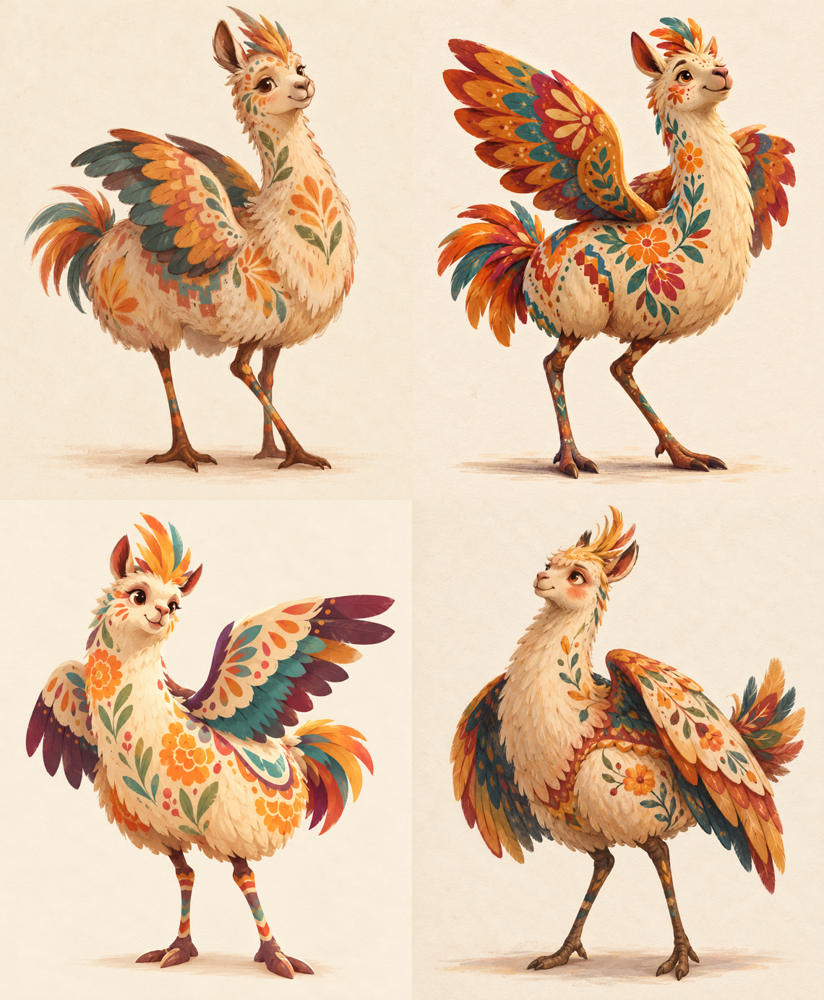
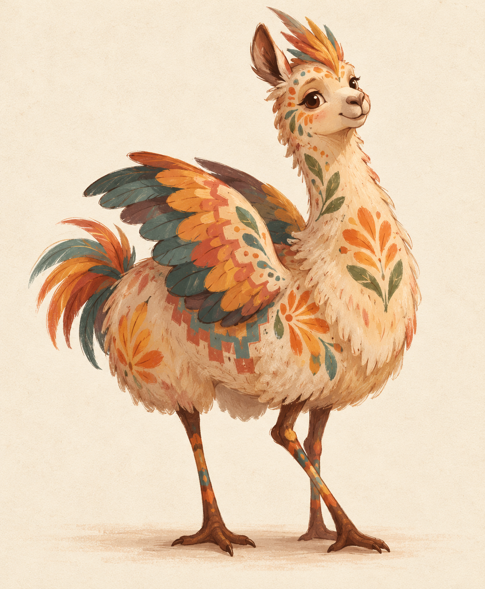
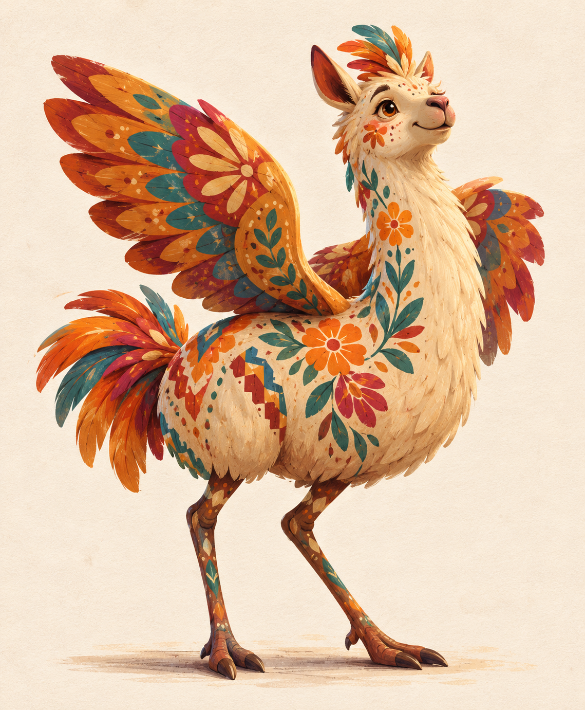
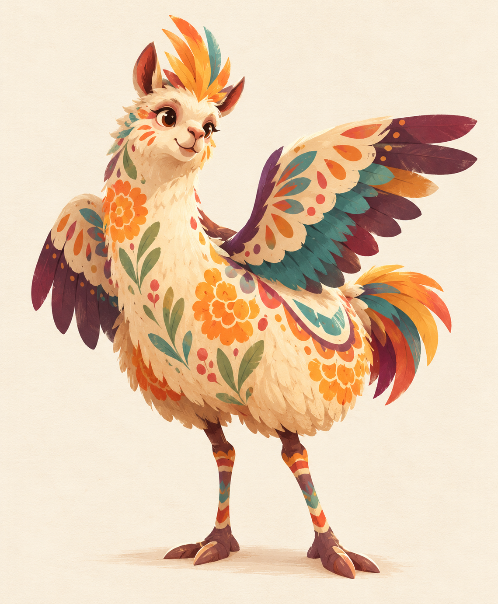
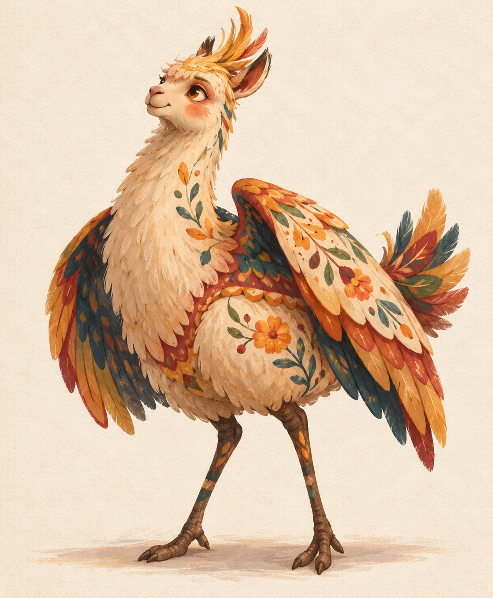

# Alpaca Alebrije — Exploration Round 01

Four style treatments of the same character recipe. These are concept images for choosing a direction, not final production assets.

Top row: A, B. Bottom row: C, D.

## Shared character brief

A single full-body, alpaca-first alebrije guide with a long alpaca neck, gentle muzzle, alert ears, fluffy chest and rounded wool body. It also has two broad bird wings, long ostrich legs, a small cockatiel crest and a short feather tail. Its gentle forward lean and kind, curious expression make it feel as though it is listening to a story.

The character is centered in a three-quarter view on a warm cream paper ground. The palette uses warmed, slightly muted Mexican folk colours. Painted florals, leaf forms, dots and stepped geometric bands follow the anatomy. The image must feel culturally grounded, handmade, affectionate and safe—never like a monster or an existing film character.

## Variants

### A — Quiet Storybook

- Colour intensity: 3/5
- Handmade texture: 4.5/5
- Stylisation: 3.5/5
- Pattern density: 2.5/5
- Whimsy: 3.5/5
- Nostalgia: 4/5
- Dimensionality: 2/5
- Character: tender, intimate, lightly awkward
- Medium: matte gouache, coloured pencil, dry brush and warm-brown line

### B — Painted Folk Sculpture

- Colour intensity: 4/5
- Handmade texture: 4/5
- Stylisation: 4/5
- Pattern density: 4/5
- Whimsy: 4/5
- Nostalgia: 3/5
- Dimensionality: 3/5
- Character: lively, crafted, celebratory
- Medium: illustrated painted wood and papier-mâché, with visible brush overlap and handmade asymmetry

### C — Paper Festival Graphic

- Colour intensity: 4/5
- Handmade texture: 3.5/5
- Stylisation: 4.5/5
- Pattern density: 3/5
- Whimsy: 4.5/5
- Nostalgia: 3/5
- Dimensionality: 1.5/5
- Character: playful, bold, UI-friendly
- Medium: flat cut paper and opaque gouache with torn and brushy edges

### D — Heirloom Guardian

- Colour intensity: 3.5/5
- Handmade texture: 4/5
- Stylisation: 3/5
- Pattern density: 3/5
- Whimsy: 3/5
- Nostalgia: 4.5/5
- Dimensionality: 2.5/5
- Character: serene, wise, protective
- Medium: opaque gouache, dry pastel and sparse ink with subtle old-print softness

## Shared negative prompt

No text, label, watermark, people, skull faces, bones, horror, Halloween, pumpkins, bats, generic “tribal” motifs, headdresses, ceremonial human clothing, sacred iconography, jaguar body, dog body, photorealism, glossy 3D rendering, neon rainbow, or resemblance to an existing film character.

## Suggested next step

Choose one structural direction (A–D), then tune no more than two scale axes at a time. The most useful next comparison would be expression, pattern density or colour intensity while keeping the chosen silhouette fixed.
