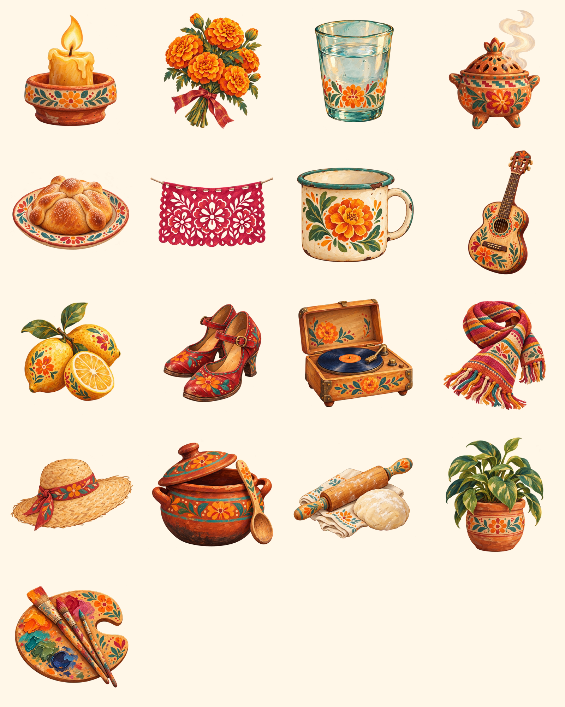

# Object Starter Set

A first object vocabulary for the **Warm Folk Reverie — Painted Folk Sculpture** direction. These are style-development assets generated with Variant B as the visual reference.

The comparison sheet follows the numbered order below, left to right and top to bottom.

## Traditional altar objects

1. `candle.png` — candle in a painted terracotta holder
2. `marigolds.png` — tied cempasúchil bouquet
3. `water-glass.png` — hand-painted glass of water
4. `copal-burner.png` — terracotta incense burner
5. `pan-de-muerto.png` — bread on a painted plate
6. `papel-picado.png` — floral cut-paper flag

## Everyday and memory objects

7. `enamel-mug.png` — worn floral enamel mug
8. `guitar.png` — hand-painted wooden guitar
9. `lemons.png` — whole and cut lemons
10. `dancing-shoes.png` — dancing represented by worn shoes
11. `record-player.png` — music represented by a record player
12. `scarf.png` — woven striped scarf
13. `hat.png` — everyday woven sun hat
14. `cooking-pot.png` — cooking represented by a clay pot and spoon
15. `baking.png` — baking represented by a rolling pin, dough and cloth
16. `house-plant.png` — leafy plant in a painted terracotta pot
17. `painting-palette.png` — painting represented by palette and brushes

## Prompt system

Each object uses the same base prompt:

> Isolated object illustration for an interactive remembrance altar app, matching the Painted Folk Sculpture direction: tactile matte gouache, visible brush overlaps, dry-brush grain, imperfect warm-brown outlines, slight handmade asymmetry, shallow painted volume and a warm earthy Mexican folk palette. Use selective cempasúchil orange, saffron, cochineal red, dusty magenta, oxidised turquoise, cactus green, indigo, ochre and cacao. Keep the complete object centred, recognisable at small size and free from text, logos, horror, Halloween imagery, glossy 3D rendering, photorealism, stereotypes and sacred motifs.

Activities are represented through tangible personal objects rather than people: shoes for dancing, a record player for music, a pot for cooking, baking tools for baking, and a palette for painting.

## Production note

These are starter concepts, not a final size-optimised icon pack. The selected PNGs use transparent backgrounds and are ready for composition tests. The `*-with-background.png` files are preserved generation drafts and are excluded from the comparison sheet.
